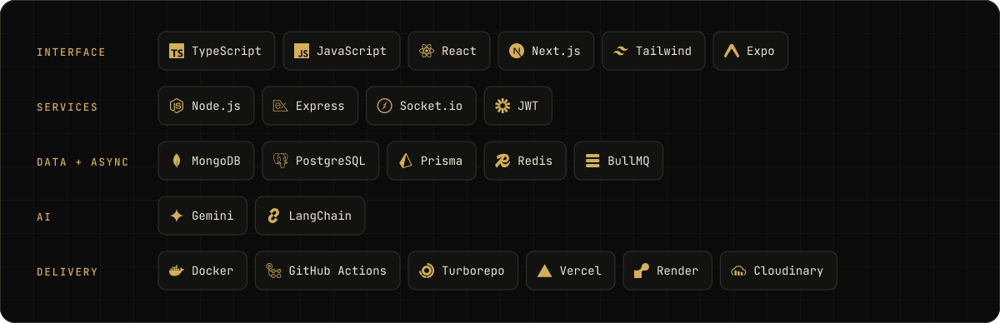

  

  <a href="https://builtbysarim.netlify.app"><b>Portfolio</b></a> &nbsp;·&nbsp;
  <a href="https://www.linkedin.com/in/muhammad-sarim-khan-dev/"><b>LinkedIn</b></a> &nbsp;·&nbsp;
  <a href="https://vertexasolutions.vercel.app"><b>Vertexa Solutions</b></a> &nbsp;·&nbsp;
  <a href="mailto:sarimkhan13579@gmail.com"><b>Email</b></a>

 

I build SaaS backends and the products on top of them. Most of my work comes down to two questions: **whose data is this**, and **what happens when this takes 30 seconds?** The answers show up as tenant boundaries, queues and workers.

I also teach the MERN stack to developers in Pakistan, run a software agency, and serve as a Microsoft Student Ambassador. Teaching keeps my explanations honest. Client work keeps my estimates honest.

 

## Two systems worth reading

**[CodeWise](https://github.com/muhammadsarim11/codewise)** explains code line by line, with complexity analysis, refactoring suggestions, shareable reports and PDF export.

- **The hard part:** an AI call takes seconds. Holding an HTTP request open for it wastes capacity and feels broken.
- **The decision:** the API enqueues and returns. A separate worker process does the slow work.

 

**EdSync** is a B2B LMS where each institute is an isolated tenant, with cohorts, curriculum, assignments, grading and live chat.

- **The hard part:** one missed filter in a shared database leaks a whole institute's data.
- **The decision:** tenant identity travels in the token, every scoped query is keyed on `organizationId`, and cross-tenant requests get a 404, so the API never confirms that another tenant's data exists.
- **The proof:** 100+ integration tests run against a real MongoDB in CI.

 

## What I work with

 

## How I build

| Principle | In practice |
|:--|:--|
| **Isolate first** | Tenant scope is designed into the schema and indexes, not added to queries later |
| **Keep requests short** | Anything slow goes to a queue, so the event loop stays free |
| **One way to fail** | Async errors flow to one global handler instead of scattered `try/catch` |
| **Test against the real thing** | Integration tests hit a real database, because mocks don't enforce a unique index |
| **Stay portable** | Open tools and free tiers first, with no vendor I can't walk away from |

 

## Right now

- Taking **EdSync** from backend to product, with a Next.js client and a React Native app
- Building business software for clients at **[Vertexa Solutions](https://vertexasolutions.vercel.app)**
- Teaching MERN batches with a curriculum I designed
- Open to **senior remote engineering roles**: [let's talk](mailto:sarimkhan13579@gmail.com)
